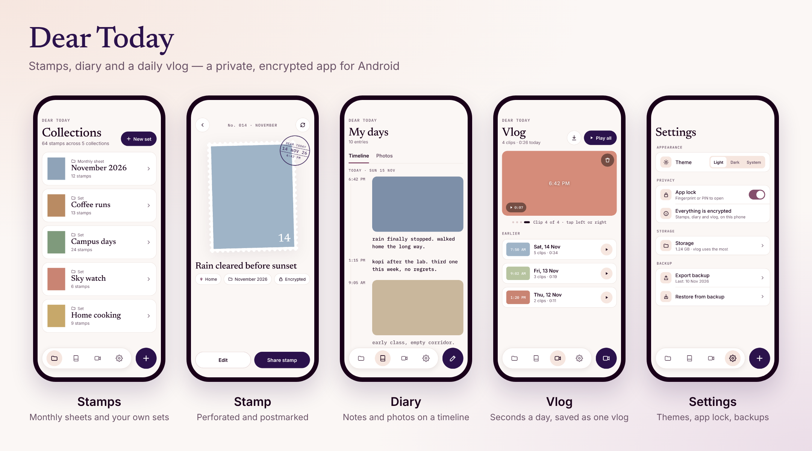

# Dear Today 💌

A small, private Android app for keeping your days: **stamps** for the nice places and moments, a **diary** timeline for everyday life, and a **daily vlog** of a few seconds at a time.

I built this for myself and use it every day. It's shared here as a portfolio project.

<p align="center">
  
</p>
<p align="center"><sub>Photos are placeholders. Light and dark screens are in <a href="docs/screenshots">docs/screenshots</a>.</sub></p>

## Features

- **Stamps**: take a photo with the in-app camera and it becomes a perforated stamp (portrait, square or wide) with a postmark. Stamps are collected on monthly sheets and in your own sets.
- **Diary**: a timeline of notes with photos, plus a Photos tab with a full-screen viewer. A note's photo can also be kept as a stamp.
- **Vlog**: record 3, 5 or 10 second landscape clips; the time is shown in the middle. Watch the day's clips in a 16:9 player (tap left or right to move between them), and save the whole day to the gallery as one video with each clip's time drawn on it.
- **Storage** page: how much space stamps, diary and vlog use, 720p / 1080p vlog quality, and freeing space by removing old clips.
- **Light, dark or system** theme (soft plum), and **app lock** with fingerprint / device credential.

## Privacy and security

Everything stays on the device. There are no accounts, no servers, and no analytics.

- **At rest:** stamps, notes, photos and clips are encrypted with AES-256-GCM. The key is randomly generated on first launch and kept in Android Keystore-backed secure storage (`flutter_secure_storage`). Every encryption uses a fresh random nonce. Large files are encrypted on a background isolate.
- **Playback and sharing:** a clip is decrypted to the app's private cache only while it plays, and those copies are cleared on the next start. Shared or exported files are temporary copies that are deleted afterwards.
- **Gallery:** nothing goes to the phone's gallery unless you ask (save a stamp or a day's vlog) or turn on *Also save to gallery*.
- **Backups:** exported as a single file encrypted with a key derived from a password you choose (PBKDF2-HMAC-SHA256, 600,000 iterations, 16-byte random salt, then AES-256-GCM). The iteration count is stored in the file header so it can be raised later without breaking old backups.
- **Android:** `allowBackup="false"`, so data isn't copied into Google's cloud backups.

**There is no password recovery.** If you forget your backup password, that backup cannot be opened. That's by design.

Backup file format (v2). Each record is encrypted separately, so a large vlog never has to fit in memory at once:

```
"DTB2" | iterations (uint32) | salt (16 bytes) | record | record | ...
record = length (uint32) | nonce | ciphertext | GCM tag
first record = the list of stamps, sets, notes and clips (JSON); then one record per photo or clip
```

## Project structure

```
lib/
├── data/       # journal store (stamps, sets, diary, clips) and settings
├── models/     # Stamp, StampSet, DiaryEntry, VlogClip
├── screens/
│   ├── stamps/     # collections, collection, stamp detail, stamp camera
│   ├── diary/      # timeline, note editor, photo viewer
│   ├── vlog/       # today's clips, clip player, vlog camera
│   └── settings/   # settings, storage, backup flows
├── security/   # vault (at-rest encryption), backup, app lock
├── services/   # day rollover clock, gallery saving, day-vlog export
├── widgets/    # stamp frame, camera view, shared UI pieces
├── utils/      # date formatting
└── theme.dart  # soft plum colours for light and dark
android/…/MainActivity.kt   # makes the day's vlog with Media3 Transformer
```

## Building

Requires Flutter (Dart SDK ^3.13) and an Android device or emulator.

```bash
flutter pub get
flutter run                  # debug
flutter build apk --release  # release APK
flutter test
```

Only Android is tested. The app relies on Android's camera, biometrics and Media3.

## Built with

[Flutter](https://flutter.dev) · [camera](https://pub.dev/packages/camera) · [video_player](https://pub.dev/packages/video_player) · [Media3 Transformer](https://developer.android.com/media/media3/transformer) · [cryptography](https://pub.dev/packages/cryptography) · [flutter_secure_storage](https://pub.dev/packages/flutter_secure_storage) · [local_auth](https://pub.dev/packages/local_auth) · [gal](https://pub.dev/packages/gal) · [google_fonts](https://pub.dev/packages/google_fonts)

---

Made by [myok0hi](https://github.com/zxhry) · [MIT License](LICENSE)
